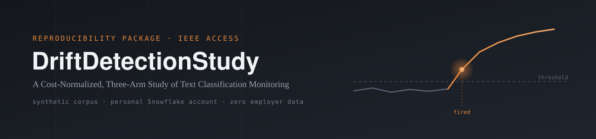

<p align="center">
  
</p>

# DriftDetectionStudy — Reproducibility Package

<p align="center">
  
  
  
  
  
</p>

Companion repository for:

> **What Kind of Drift Determines Which Signal Sees It: A Cost-Normalized,
> Three-Arm Study of Text Classification Monitoring**
> J. Ramalingam, submitted to IEEE Access.

This repository contains the corpus generator, detection-signal SQL, and
threshold policy needed to reproduce every result reported in the paper.
No employer data, systems, or taxonomy are used anywhere in this package —
the corpus is entirely synthetic and the experiments run on a personal
Snowflake account.

---

## 1. What's in this repo

| File | Purpose |
|---|---|
| `python/generate_311_corpus.py` | Synthetic municipal-311 corpus generator with drift injection (arms B, C, D) |
| `python/Loader.py` | Loads generated JSONL files into the Snowflake `daily_records` table |
| `sql/classify_calibration.sql` | Zero-shot classification of the reference window (days 15–34) |
| `sql/drift_signals.sql` | Tier 1 (S1–S3), Tier 2 (S4–S6), and Tier 3 (S7a) signal computation |
| `DESIGN.md` | Mid-project experimental design doc (superseded by the paper; kept for history) |
| `corpus/` | Pre-generated corpus data (arms BASE, B, C, D — 90 days each, ready to load) |
| `README.md` | This file |

---

## 2. Requirements

- Python 3.9+, no external packages beyond the standard library for corpus
  generation
- A Snowflake account with Cortex AI Functions enabled (`AI_CLASSIFY`,
  `AI_EMBED`)
- `snowflake-connector-python` if loading via script rather than Snowsight
  file upload
- An isolated virtual warehouse (XSMALL is sufficient) — isolation matters
  for credit attribution, not raw compute needs

**Cost estimate for a full reproduction, at the rates measured during the
original study (subject to change — verify current Snowflake AI pricing
before running):**

| Item | Approx. cost |
|---|---|
| Calibration classification (40,000 calls, shared across arms) | ~$26 |
| Each arm's measurement-window classification (110,000 calls) | ~$74 |
| All Tier 1 (SQL) and Tier 2 (embedding) signals, all arms combined | < $1 |
| **Full three-arm reproduction** | **~$250** |

Tier 1 and Tier 2 signals alone (no classification, no S7a) reproduce the
paper's central finding — that new-content drift is detected by six of
seven signals regardless of prevalence, while reassignment drift is caught
only by nearest-neighbor distance — at a cost of well under $1.

---

## 3. Step-by-step reproduction

### 3.1 Generate the corpus (no cloud cost)

The `corpus/` directory already ships pre-generated data for arms BASE, B,
C, and D — you can skip straight to [3.2](#32-load-into-snowflake). To
regenerate it yourself instead:

```bash
python python/generate_311_corpus.py --arm BASE --out ./corpus
python python/generate_311_corpus.py --arm B --magnitude medium --out ./corpus
python python/generate_311_corpus.py --arm C --magnitude medium --out ./corpus
python python/generate_311_corpus.py --arm D --magnitude medium --out ./corpus
```

Each arm produces 90 daily JSONL files (`day_000.jsonl` … `day_089.jsonl`)
under `./corpus/<arm>/`. Days 0–34 are byte-identical across all four arms
by construction.

**Validate before loading anything:**

```bash
python python/generate_311_corpus.py --validate ./corpus/BASE
```

Expect `GATE PASSED`. If any Tier 1 signal fires during the reference
window (days 15–34), the corpus is not stable and must not be used —
every downstream detection-lag result depends on this window being clean.

### 3.2 Load into Snowflake

Create the target objects:

```sql
CREATE DATABASE IF NOT EXISTS DT_STUDY;
CREATE SCHEMA IF NOT EXISTS DT_STUDY.DRIFT;
CREATE WAREHOUSE IF NOT EXISTS DRIFT_WH
  WAREHOUSE_SIZE = 'XSMALL' AUTO_SUSPEND = 60 AUTO_RESUME = TRUE;

CREATE OR REPLACE TABLE DT_STUDY.DRIFT.daily_records (
    record_id   STRING,
    arm         STRING,
    day_index   INT,
    text        STRING,
    true_label  STRING,
    load_ts     TIMESTAMP_NTZ DEFAULT CURRENT_TIMESTAMP()
);
```

Load each arm's JSONL files via `PUT` + `COPY INTO` (JSON file format) or
your preferred loader. Confirm after each load:

```sql
SELECT arm, MIN(day_index), MAX(day_index),
       COUNT(DISTINCT day_index), COUNT(*)
FROM DT_STUDY.DRIFT.daily_records
WHERE arm = '<ARM>'
GROUP BY arm;
```

Expect 90 days, 180,000 rows, per arm.

### 3.3 Reference-window classification (run once, reused by every arm)

```sql
-- run the CREATE TABLE block in sql/classify_calibration.sql
```

This uses the bare 10-label array. **Do not use per-label descriptions** —
an earlier configuration using them was measured to increase per-call
token consumption by close to two orders of magnitude with no accuracy
benefit (see Section III-D of the paper). Arm C requires an 11-label
variant including the novel class; build a second calibration table for
that arm specifically (see Section V-B of the paper for why this matters).

### 3.4 Tier 1 signals (S1, S2, S3) — free, per arm

Run the tokenization, S1 (Kolmogorov–Smirnov on length), S2 (vocabulary
novelty), and S3 (type-token ratio deviation) blocks in
`sql/drift_signals.sql`, substituting the target arm in each
`WHERE arm = '<ARM>'` clause.

### 3.5 Tier 2 signals (S4, S5, S6) — near-free, per arm

Run the Tier 2 blocks in `sql/drift_signals.sql` end to end, substituting
the target arm throughout. Confirm row counts at each checkpoint before
proceeding to the next step — an empty intermediate table is a common
failure mode and is cheaper to catch early than at the final signal
computation.

### 3.6 Tier 3 signal (S7a) — the paid step

```sql
CREATE OR REPLACE TABLE DT_STUDY.DRIFT.predictions_arm_<X> AS
SELECT arm, day_index, record_id, true_label,
       AI_CLASSIFY(text, [ /* label array, see Section III-D */ ]
       ):labels[0]::VARCHAR AS predicted_label
FROM DT_STUDY.DRIFT.daily_records
WHERE arm = '<ARM>' AND day_index BETWEEN 35 AND 89;
```

Then normalize renamed labels back to their canonical form and compute
the chi-square statistic per `sql/drift_signals.sql`'s S7a block.

### 3.7 Threshold and detection

One policy applied to every signal, every arm:

```sql
-- fires on day d if statistic(d) > mean(ref) + 3*stdev(ref)
-- AND statistic(d-1) also exceeded that threshold
```

Reference window is days 15–34 for all Tier 1/2 signals; for S7a, use the
true reference-window predictions (`predictions_calibration`), not an
early-measurement-window proxy — see Section V-B of the paper for the
failure mode this avoids.

---

## 4. Expected results

| Signal | Arm B (100%) | Arm C (≈15%) | Arm D (≤30%) |
|---|---|---|---|
| S1 | not detected | not detected | not detected |
| S2 | 1 day | 1 day | not detected |
| S3 | 1 day | 1 day | not detected |
| S4 | 1 day | 1 day | not detected |
| S5 | 1 day | 9 days | not detected |
| S6 | 1 day | 1 day | not detected |
| S7a | not detected | 1 day | 34 days |

If your reproduction diverges meaningfully from this table, check first
whether the reference window (days 15–34) is genuinely stable in your
generated corpus, and second whether the classifier label array matches
exactly (bare labels, no descriptions, with the two renamed labels
documented in Section III-D).

---

## 5. Notes on independence

This corpus, taxonomy, and all reported results were generated
independently on personally provisioned cloud infrastructure, using
synthetic data with an invented domain and label set. No production
system, employer data, or proprietary taxonomy is represented anywhere in
this repository.

---

## 6. Citation

If you use this code or corpus generator, please cite:

```
J. Ramalingam, "What Kind of Drift Determines Which Signal Sees It:
A Cost-Normalized, Three-Arm Study of Text Classification Monitoring,"
IEEE Access, [year, volume, pages once assigned].
```
